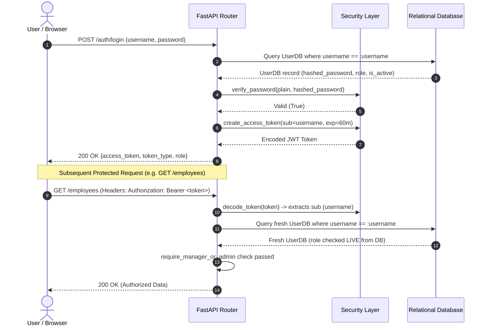
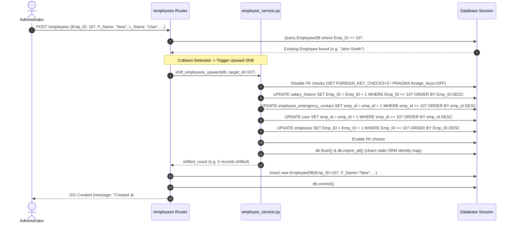
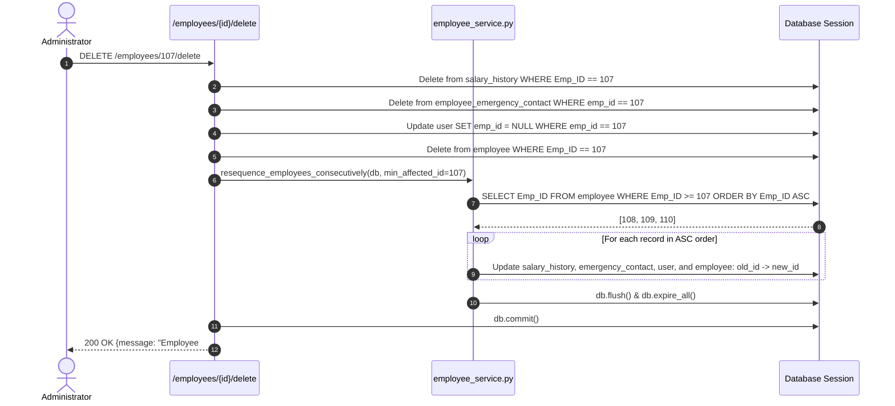
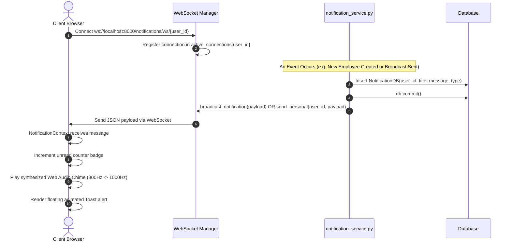

# Architecture & Data Specification

**Project:** Enterprise Employee & Payroll Management System  
**Version:** 2.6  
**Date:** October 31, 2026  
**Scope:** Frontend, Backend, Database, Real-Time Networking & Data Pipeline  

---

## 1. System Architecture Overview

The system implements a decoupled, modern client-server architecture consisting of a **React 19 Single Page Application (SPA)** powered by Vite, communicating with an asynchronous **FastAPI REST & WebSocket Backend** backed by a relational database (**MySQL** in production, **SQLite** for development and test execution).

```
+-----------------------------------------------------------------------------------+
|                                  CLIENT TIER                                      |
|                                                                                   |
|   +---------------------------------------------------------------------------+   |
|   |                      React 19 + Vite Single Page Application              |   |
|   |                                                                           |   |
|   |  - React Router 6 (Auth Guards)       - NotificationContext (WebSockets)  |   |
|   |  - ThemeProvider (Dark / Light)       - Modular Components & Modals       |   |
|   |  - api.js (Unified HTTP Fetch Layer)  - Native CSS Design Tokens          |   |
|   +---------------------------------------------------------------------------+   |
+------------------------------------------+----------------------------------------+
                                           |
                    HTTPS (REST API)       |        WSS (Push Events)
                                           v
+-----------------------------------------------------------------------------------+
|                                  SERVER TIER                                      |
|                                                                                   |
|   +---------------------------------------------------------------------------+   |
|   |                         FastAPI Application Server                        |   |
|   |                                                                           |   |
|   |  +------------------------+   +-------------------+   +----------------+  |   |
|   |  |     API Routers        |   |   Security Layer  |   | Rate Limiter   |  |   |
|   |  | - /auth     - /salaries|   | - JWT (HS256)     |   | - slowapi      |  |   |
|   |  | - /employees- /reports |   | - passlib/bcrypt  |   | (10 & 60 /min) |  |   |
|   |  | - /depts    - /holidays|   | - RBAC Guards     |   |                |  |   |
|   |  | - /profile  - /notifs  |   |                   |   +----------------+  |   |
|   |  | - /attendance          |   |                   |                       |   |
|   |  +------------------------+   +-------------------+                       |   |
|   |                                                                           |   |
|   |  +---------------------------------------------------------------------+  |   |
|   |  |                        Service Business Logic Layer                 |  |   |
|   |  | - employee_service.py (Auto-Shift & Consecutive Resequencing)       |  |   |
|   |  | - excel_service.py    (XLSX/CSV Import, Bulk Ops & pure-XML parsing)|  |   |
|   |  | - pdf_service.py      (ReportLab Document Generation Hub)           |  |   |
|   |  | - notification_service.py (WebSocket Manager & Push Dispatcher)     |  |   |
|   |  | - email_service.py    (Corporate Email Deterministic Generator)     |  |   |
|   |  +---------------------------------------------------------------------+  |   |
|   +---------------------------------------------------------------------------+   |
+------------------------------------------+----------------------------------------+
                                           |
                              SQLAlchemy ORM (Connection Pool)
                                           v
+-----------------------------------------------------------------------------------+
|                                   DATA TIER                                       |
|                                                                                   |
|   +---------------------------------------------------------------------------+   |
|   |                   Relational Database Management System                   |   |
|   |                                                                           |   |
|   |  - employee                  - salary_history        - department         |   |
|   |  - user                      - password_reset_token  - department_history |   |
|   |  - employee_emergency_contact- holiday               - notification       |   |
|   |  - announcement              - system_setting                             |   |
|   |                                                                           |   |
|   |   Dialects: MySQL 8.x (Production) | SQLite 3 (Testing & Dev)             |   |
|   +---------------------------------------------------------------------------+   |
+-----------------------------------------------------------------------------------+
```

---

## 2. Component & Layer Details

### 2.1 Backend Layering (FastAPI)

```
employee_api/
├── app/
│   ├── auth/              # Security, JWT tokens, password hashing, and dependency injection
│   │   ├── dependencies.py# require_admin, require_manager_or_admin, get_current_user
│   │   └── security.py    # bcrypt hashing, verify_password, create_access_token
│   ├── config.py          # Environment settings, secret keys, rate limiter instance
│   ├── database.py        # SQLAlchemy Engine, SessionLocal, Base metadata declaration
│   ├── main.py            # FastAPI entry point, CORS middleware, WebSocket & route registration
│   ├── models/            # SQLAlchemy declarative database models
│   │   ├── attendance.py  # AttendanceDB, AttendanceBreakDB, AttendanceRegularizationDB
│   │   ├── department.py  # DepartmentDB, DepartmentHistoryDB
│   │   ├── employee.py    # EmployeeDB, SalaryHistoryDB, EmergencyContactDB
│   │   ├── holiday.py     # HolidayDB, AnnouncementDB
│   │   ├── notification.py# NotificationDB
│   │   ├── system_setting.py# SystemSettingDB (session timeout & portal config)
│   │   └── user.py        # UserDB, PasswordResetTokenDB
│   ├── routers/           # HTTP & WebSocket route handlers
│   │   ├── analytics.py   # Headcount metrics, department budget summaries
│   │   ├── attendance.py  # Clock in/out, break tracking, regularization, team roster, CSV/PDF
│   │   ├── auth.py        # Register, login, session timeout policy, token refresh, password reset
│   │   ├── departments.py # Department CRUD & budget revisions
│   │   ├── employees.py   # Employee CRUD, bulk delete/restore, auto-shift, Excel endpoints
│   │   ├── health.py      # Liveness & readiness probes
│   │   ├── holidays.py    # Holiday schedules, announcements, business days simulator
│   │   ├── notifications.py# WebSocket endpoint (/ws/{user_id}), notification inbox
│   │   ├── profile.py     # Self-service personal profile & emergency SOS contacts
│   │   ├── reports.py     # PDF generation & binary download streams
│   │   └── salaries.py    # Salary updates, bulk percentage increment, Indian payroll breakdown
│   ├── schemas/           # Pydantic v2 request/response validation schemas
│   └── services/          # Core algorithmic and heavy I/O business logic
│       ├── email_service.py        # Collision-resistant corporate email generator
│       ├── employee_service.py     # Upward auto-shift, consecutive resequencing, data masking
│       ├── excel_service.py        # Spreadsheet parsing, pure Python XML fallback, batch imports
│       ├── notification_service.py # Active WebSocket connection registry & notification dispatcher
│       └── pdf_service.py          # ReportLab Indian payslips, revision letters, headcount rosters
```

### 2.2 Frontend Architecture (React 19 + Vite)

The frontend is structured as a modular component hierarchy with clean state boundaries:

- **Routing & Guards (`App.jsx`):** Employs `react-router-dom` v6 with declarative route definitions. Routes are protected via `<RequireAuth allowedRoles={[...]} />`. Unauthorized or expired sessions redirect to `/login`, preserving `logout_reason` and duration via query parameters and `sessionStorage`.
- **Privacy Shield & Adblocker Resilience:** Resilient lazy-loading of compliance components (`PrivacyNotice.jsx`) with rejection error trapping, ensuring browser privacy shields (like Brave Shields) never cause blank screen crashes on login or dashboard routes.
- **Session Timeout & Inactivity Management:**
  - `SessionTimeoutManager.jsx`: Global inactivity detector listening across desktop and mobile devices (`mousedown`, `keydown`, `touchstart`, `scroll`, `visibilitychange`), broadcasting 1-second countdown ticks, and triggering automatic logout upon expiration.
  - `SessionIdleBadge.jsx`: Real-time countdown badge mounted in the topbar (`⏳ 14:48`) with click-to-extend functionality and urgent amber/red alert states.
  - `SessionTimeoutModal.jsx`: Administrative configuration dialog with quick testing presets (1, 2, 5, 10, 15, 30, 45, 60, 120 min) and global auto-logout toggle.
- **Modern Authentication Experience (`Login.jsx`):** Split-screen layout featuring a dynamic cybernetic attendance showcase on the left (live clock, system date, greeting, attendance metrics without photos/logos) and an elevated 3D card flip form on the right (Sign In, Account Recovery, Registration) with fully reactive Light and Dark theme variable styling.
- **Attendance & Time-Tracking Module (`Attendance.jsx`):** Daily punch terminal supporting punch-in/out, work modes (office/WFH/hybrid), active shift timers, intermittent break tracking, manual manager adjustments, attendance regularization requests, live company rosters, and monthly timesheet statement exports.
- **Universal Smartphone & All-Screen Responsive Architecture:** Responsive CSS viewport architecture using `min-height: 100dvh`, environment safe area insets (`env(safe-area-inset-top)` / `bottom` / `left` / `right`), touch-scrolling optimization, and adaptive flex layouts with `margin: auto auto` guaranteeing zero vertical clipping or UI button occlusion across Android and iOS smartphone form factors.
- **API Client Layer (`api.js`):** Unified fetch abstraction handling JSON payloads, URL search parameters, authorization header injection (`Bearer <token>`), automatic 401 token invalidation triggers, and friendly error unwrapping.
- **Context Providers:**
  - `NotificationContext.jsx`: Manages live WebSocket lifecycle, automatic reconnect backoff, synthesized Web Audio chime, floating toast queue, and unread badge state.
  - `theme.jsx`: Toggles `data-theme="light"` and `data-theme="dark"` on `document.documentElement`, persisted in `localStorage`.
- **Dual-Sync Architecture:**
  - Primary source directory: `employee_frontend/src/`
  - Mirrored production directory: `employee_api/frontend/src/`
  - *Invariant:* All edits to `employee_frontend/src/` must be synchronized to `employee_api/frontend/src/`.

---

## 3. End-to-End Data Flow Diagrams

### 3.1 Authentication & Live Role Verification



---

### 3.2 Employee Creation with Auto-Shift Upward Sequence

When an administrator creates a new employee specifying an `Emp_ID` currently occupied by an existing record:



---

### 3.3 Employee Deletion with Consecutive Resequencing

When an employee is permanently removed, remaining records are shifted downward to preserve consecutive numbering:



---

### 3.4 Real-Time Push Notification Pipeline



---

## 4. Database Transaction & Session Lifecycle

```
[ Incoming Request ]
         │
         ▼
[ get_db Dependency ] ───► Creates db: Session = SessionLocal()
         │
         ▼
[ Business Logic / CRUD ]
         │
    ┌────┴────────────────────────┐
    │                             │
[ Success ]                   [ Exception ]
    │                             │
    ▼                             ▼
db.commit()                   db.rollback()
    │                             │
    └────┬────────────────────────┘
         │
         ▼
[ Finally Block ] ───────► db.close() (Session returned to connection pool)
```

### 4.1 ORM Session Invariants
1. **Explicit Identity Map Expiration:** Following any bulk or raw SQL execution (`db.execute(text(...))`), `db.flush()` and `db.expire_all()` **must** be called immediately. This purges stale cached object instances in SQLAlchemy's identity map and avoids `SAWarning` conflicts.
2. **Dialect-Aware Foreign Key Handling:**
   - **MySQL:** `SET FOREIGN_KEY_CHECKS = 0;` ... `SET FOREIGN_KEY_CHECKS = 1;`
   - **SQLite:** `PRAGMA foreign_keys = OFF;` ... `PRAGMA foreign_keys = ON;`

---

## 5. Network & Deployment Topology

| Service | Protocol | Default Port | Environment Variable | Purpose |
|---|---|---|---|---|
| **FastAPI Backend** | HTTP / REST | `8000` | `PORT`, `HOST=0.0.0.0` | API application server |
| **Notifications WS**| WebSocket | `8000` | `VITE_API_URL` | Real-time push stream |
| **Vite Dev Server** | HTTP | `5173` | `VITE_PORT` | Local frontend development |
| **Production Client**| HTTP / Static| `4173` (preview) / NGINX | - | Production static web hosting |
| **MySQL Database**  | TCP / MySQL | `3306` | `DATABASE_URL` | Production persistent storage |

