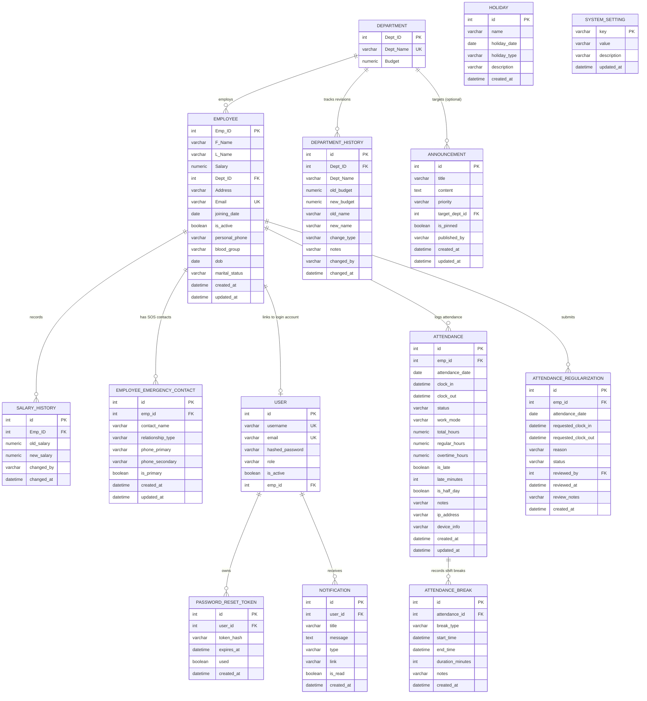

# Database Architecture & Schema Specification

**Project:** Enterprise Employee & Payroll Management System  
**Version:** 2.6  
**Date:** October 31, 2026  
**Engines Supported:** MySQL 8.x (Production) | SQLite 3 (Automated Testing & Local Dev)  

---

## 1. Entity-Relationship (ER) Diagram



---

## 2. Table DDL & Schema Definitions

### 2.1 Table: `department`
Stores corporate organizational departments and annual operating budgets.
```sql
CREATE TABLE department (
    Dept_ID INT AUTO_INCREMENT PRIMARY KEY,
    Dept_Name VARCHAR(50) NOT NULL UNIQUE,
    Budget DECIMAL(20, 2) NULL
);
```

### 2.2 Table: `department_history`
Audit log recording every modification to department budgets and names.
```sql
CREATE TABLE department_history (
    id INT AUTO_INCREMENT PRIMARY KEY,
    Dept_ID INT NULL,
    Dept_Name VARCHAR(50) NOT NULL,
    old_budget DECIMAL(18, 2) NULL,
    new_budget DECIMAL(18, 2) NULL,
    old_name VARCHAR(50) NULL,
    new_name VARCHAR(50) NULL,
    change_type VARCHAR(30) NOT NULL, -- 'CREATED', 'BUDGET_REVISED', 'NAME_CHANGED', etc.
    notes VARCHAR(255) NULL,
    changed_by VARCHAR(50) NULL,
    changed_at DATETIME DEFAULT CURRENT_TIMESTAMP,
    FOREIGN KEY (Dept_ID) REFERENCES department (Dept_ID) ON DELETE SET NULL
);
```

### 2.3 Table: `employee`
Primary employee records holding organizational and personal self-service attributes.
```sql
CREATE TABLE employee (
    Emp_ID INT PRIMARY KEY,
    F_Name VARCHAR(50) NOT NULL,
    L_Name VARCHAR(50) NOT NULL,
    Salary DECIMAL(20, 2) NOT NULL,
    Dept_ID INT NOT NULL,
    Address VARCHAR(500) NOT NULL,
    Email VARCHAR(100) UNIQUE NULL,
    joining_date DATE NULL,
    is_active BOOLEAN NOT NULL DEFAULT TRUE,
    personal_phone VARCHAR(20) NULL,
    blood_group VARCHAR(10) NULL,       -- 'A+', 'B+', 'O+', etc.
    dob DATE NULL,                      -- Date of Birth
    marital_status VARCHAR(20) NULL,    -- 'Single', 'Married', 'Divorced', 'Widowed'
    created_at DATETIME DEFAULT CURRENT_TIMESTAMP,
    updated_at DATETIME DEFAULT CURRENT_TIMESTAMP ON UPDATE CURRENT_TIMESTAMP,
    FOREIGN KEY (Dept_ID) REFERENCES department (Dept_ID)
);
```

### 2.4 Table: `salary_history`
Append-only compensation revision audit log.
```sql
CREATE TABLE salary_history (
    id INT AUTO_INCREMENT PRIMARY KEY,
    Emp_ID INT NOT NULL,
    old_salary DECIMAL(20, 2) NOT NULL,
    new_salary DECIMAL(20, 2) NOT NULL,
    changed_by VARCHAR(50) NULL,
    changed_at DATETIME DEFAULT CURRENT_TIMESTAMP,
    FOREIGN KEY (Emp_ID) REFERENCES employee (Emp_ID)
);
```

### 2.5 Table: `employee_emergency_contact`
Emergency contact directory cards (SOS contacts) supporting primary contact indicators.
```sql
CREATE TABLE employee_emergency_contact (
    id INT AUTO_INCREMENT PRIMARY KEY,
    emp_id INT NOT NULL,
    contact_name VARCHAR(100) NOT NULL,
    relationship_type VARCHAR(50) NOT NULL, -- 'Spouse', 'Parent', 'Sibling', 'Child', 'Friend', 'Other'
    phone_primary VARCHAR(20) NOT NULL,
    phone_secondary VARCHAR(20) NULL,
    is_primary BOOLEAN NOT NULL DEFAULT FALSE,
    created_at DATETIME DEFAULT CURRENT_TIMESTAMP,
    updated_at DATETIME DEFAULT CURRENT_TIMESTAMP ON UPDATE CURRENT_TIMESTAMP,
    FOREIGN KEY (emp_id) REFERENCES employee (Emp_ID) ON DELETE CASCADE,
    INDEX idx_emp_id (emp_id)
);
```

### 2.6 Table: `user`
Authentication identities, password credentials, and authorization roles.
```sql
CREATE TABLE user (
    id INT AUTO_INCREMENT PRIMARY KEY,
    username VARCHAR(50) NOT NULL UNIQUE,
    email VARCHAR(100) UNIQUE NULL,
    hashed_password VARCHAR(255) NOT NULL,
    role VARCHAR(20) NOT NULL DEFAULT 'user', -- 'admin', 'manager', 'user'
    is_active BOOLEAN NOT NULL DEFAULT TRUE,
    emp_id INT NULL,
    FOREIGN KEY (emp_id) REFERENCES employee (Emp_ID) ON DELETE SET NULL
);
```

### 2.7 Table: `password_reset_token`
Cryptographic single-use tokens for self-service password reset flows.
```sql
CREATE TABLE password_reset_token (
    id INT AUTO_INCREMENT PRIMARY KEY,
    user_id INT NOT NULL,
    token_hash VARCHAR(255) NOT NULL,
    expires_at DATETIME NOT NULL,
    used BOOLEAN NOT NULL DEFAULT FALSE,
    created_at DATETIME DEFAULT CURRENT_TIMESTAMP,
    FOREIGN KEY (user_id) REFERENCES user (id) ON DELETE CASCADE,
    INDEX idx_token_hash (token_hash)
);
```

### 2.8 Table: `holiday`
Corporate annual holiday schedule.
```sql
CREATE TABLE holiday (
    id INT AUTO_INCREMENT PRIMARY KEY,
    name VARCHAR(100) NOT NULL,
    holiday_date DATE NOT NULL,
    holiday_type VARCHAR(50) NOT NULL DEFAULT 'National', -- 'National', 'Festival', 'Company', 'Optional'
    description VARCHAR(255) NULL,
    created_at DATETIME DEFAULT CURRENT_TIMESTAMP,
    INDEX idx_holiday_date (holiday_date)
);
```

### 2.9 Table: `announcement`
Organization bulletins with department targeting and priority tags.
```sql
CREATE TABLE announcement (
    id INT AUTO_INCREMENT PRIMARY KEY,
    title VARCHAR(150) NOT NULL,
    content TEXT NOT NULL,
    priority VARCHAR(20) NOT NULL DEFAULT 'general', -- 'urgent', 'important', 'general', 'event'
    target_dept_id INT NULL,
    is_pinned BOOLEAN NOT NULL DEFAULT FALSE,
    published_by VARCHAR(50) NOT NULL,
    created_at DATETIME DEFAULT CURRENT_TIMESTAMP,
    updated_at DATETIME DEFAULT CURRENT_TIMESTAMP ON UPDATE CURRENT_TIMESTAMP,
    FOREIGN KEY (target_dept_id) REFERENCES department (Dept_ID) ON DELETE SET NULL
);
```

### 2.10 Table: `notification`
Persistent notification inbox and push broadcast history.
```sql
CREATE TABLE notification (
    id INT AUTO_INCREMENT PRIMARY KEY,
    user_id INT NOT NULL,
    title VARCHAR(200) NOT NULL,
    message TEXT NOT NULL,
    type VARCHAR(50) NOT NULL DEFAULT 'info', -- 'announcement', 'employee', 'salary', 'system', 'warning', etc.
    link VARCHAR(255) NULL,
    is_read BOOLEAN NOT NULL DEFAULT FALSE,
    created_at DATETIME DEFAULT CURRENT_TIMESTAMP,
    FOREIGN KEY (user_id) REFERENCES user (id) ON DELETE CASCADE,
    INDEX idx_user_read (user_id, is_read)
);
```

### 2.11 Table: `system_setting`
Stores global system configuration, security policies, and inactivity session timeouts.
```sql
CREATE TABLE system_setting (
    `key` VARCHAR(50) PRIMARY KEY,
    `value` VARCHAR(255) NOT NULL,
    description VARCHAR(255) NULL,
    updated_at DATETIME DEFAULT CURRENT_TIMESTAMP ON UPDATE CURRENT_TIMESTAMP
);
```
**Standard Key-Value Catalog:**
- `session_timeout_minutes`: Global inactivity timeout in minutes (default: `"15"`).
- `session_auto_logout_idle`: Toggle (`"true"` or `"false"`) determining whether inactive users are automatically logged out.

### 2.12 Table: `attendance`
Stores daily attendance clock-in/out records, work modes, net productive hours, and punctuality flags.
```sql
CREATE TABLE attendance (
    id INT AUTO_INCREMENT PRIMARY KEY,
    emp_id INT NOT NULL,
    attendance_date DATE NOT NULL,
    clock_in DATETIME NULL,
    clock_out DATETIME NULL,
    status VARCHAR(30) NOT NULL DEFAULT 'present', -- 'present', 'late', 'half_day', 'absent', 'on_leave', 'holiday', 'wfh'
    work_mode VARCHAR(20) NOT NULL DEFAULT 'office', -- 'office', 'remote', 'hybrid'
    total_hours DECIMAL(5, 2) NOT NULL DEFAULT 0.00,
    regular_hours DECIMAL(5, 2) NOT NULL DEFAULT 0.00,
    overtime_hours DECIMAL(5, 2) NOT NULL DEFAULT 0.00,
    is_late BOOLEAN NOT NULL DEFAULT FALSE,
    late_minutes INT NOT NULL DEFAULT 0,
    is_half_day BOOLEAN NOT NULL DEFAULT FALSE,
    notes VARCHAR(500) NULL,
    ip_address VARCHAR(50) NULL,
    device_info VARCHAR(255) NULL,
    created_at DATETIME DEFAULT CURRENT_TIMESTAMP,
    updated_at DATETIME DEFAULT CURRENT_TIMESTAMP ON UPDATE CURRENT_TIMESTAMP,
    FOREIGN KEY (emp_id) REFERENCES employee (Emp_ID) ON DELETE CASCADE,
    UNIQUE KEY uq_emp_attendance_date (emp_id, attendance_date),
    INDEX idx_emp_date (emp_id, attendance_date),
    INDEX idx_status (status)
);
```

### 2.13 Table: `attendance_break`
Tracks intermittent breaks (lunch, tea, personal) taken during an active shift, deducted from total working hours.
```sql
CREATE TABLE attendance_break (
    id INT AUTO_INCREMENT PRIMARY KEY,
    attendance_id INT NOT NULL,
    break_type VARCHAR(30) NOT NULL DEFAULT 'lunch', -- 'lunch', 'tea', 'personal', 'meeting'
    start_time DATETIME NOT NULL,
    end_time DATETIME NULL,
    duration_minutes INT NOT NULL DEFAULT 0,
    notes VARCHAR(255) NULL,
    created_at DATETIME DEFAULT CURRENT_TIMESTAMP,
    FOREIGN KEY (attendance_id) REFERENCES attendance (id) ON DELETE CASCADE,
    INDEX idx_attendance_break (attendance_id)
);
```

### 2.14 Table: `attendance_regularization`
Employee requests for missing punch rectification, technical glitch corrections, and manager approval workflows.
```sql
CREATE TABLE attendance_regularization (
    id INT AUTO_INCREMENT PRIMARY KEY,
    emp_id INT NOT NULL,
    attendance_date DATE NOT NULL,
    requested_clock_in DATETIME NULL,
    requested_clock_out DATETIME NULL,
    reason VARCHAR(500) NOT NULL,
    status VARCHAR(20) NOT NULL DEFAULT 'pending', -- 'pending', 'approved', 'rejected'
    reviewed_by INT NULL,
    reviewed_at DATETIME NULL,
    review_notes VARCHAR(500) NULL,
    created_at DATETIME DEFAULT CURRENT_TIMESTAMP,
    FOREIGN KEY (emp_id) REFERENCES employee (Emp_ID) ON DELETE CASCADE,
    FOREIGN KEY (reviewed_by) REFERENCES employee (Emp_ID) ON DELETE SET NULL,
    INDEX idx_emp_reg (emp_id, attendance_date),
    INDEX idx_reg_status (status)
);
```

---

## 3. Resequencing & Auto-Shift Algorithms

The system guarantees that employee identifiers are always consecutive and that newly inserted employees never overwrite existing records.

### 3.1 Upward Shift on Insert (`shift_employees_upward`)
When inserting into an existing `target_id`:
1. Check if any employee exists with `Emp_ID >= target_id`.
2. Disable foreign key checks.
3. Update `salary_history`, `employee_emergency_contact`, `user`, and `employee` in **DESCENDING order** (`ORDER BY Emp_ID DESC`).
4. Re-enable foreign key checks.
5. Execute `db.flush()` and `db.expire_all()` to clear cached instances from SQLAlchemy's session.

```python
def shift_employees_upward(db: Session, target_id: int) -> int:
    dialect_name = db.bind.dialect.name if db.bind else "sqlite"
    count = db.execute(
        text("SELECT COUNT(*) FROM employee WHERE Emp_ID >= :target_id"),
        {"target_id": target_id}
    ).scalar() or 0

    if count == 0:
        return 0

    if dialect_name == "mysql":
        db.execute(text("SET FOREIGN_KEY_CHECKS = 0"))
        db.execute(text("UPDATE salary_history SET Emp_ID = Emp_ID + 1 WHERE Emp_ID >= :target_id ORDER BY Emp_ID DESC"), {"target_id": target_id})
        db.execute(text("UPDATE employee_emergency_contact SET emp_id = emp_id + 1 WHERE emp_id >= :target_id ORDER BY emp_id DESC"), {"target_id": target_id})
        db.execute(text("UPDATE user SET emp_id = emp_id + 1 WHERE emp_id >= :target_id ORDER BY emp_id DESC"), {"target_id": target_id})
        db.execute(text("UPDATE employee SET Emp_ID = Emp_ID + 1 WHERE Emp_ID >= :target_id ORDER BY Emp_ID DESC"), {"target_id": target_id})
        db.execute(text("SET FOREIGN_KEY_CHECKS = 1"))
    else:
        # SQLite ordered iteration
        if dialect_name == "sqlite":
            db.execute(text("PRAGMA foreign_keys = OFF"))
        higher_ids = [r[0] for r in db.execute(
            text("SELECT Emp_ID FROM employee WHERE Emp_ID >= :target_id ORDER BY Emp_ID DESC"),
            {"target_id": target_id}
        ).fetchall()]
        for old_id in higher_ids:
            new_id = old_id + 1
            db.execute(text("UPDATE salary_history SET Emp_ID = :new_id WHERE Emp_ID = :old_id"), {"new_id": new_id, "old_id": old_id})
            db.execute(text("UPDATE employee_emergency_contact SET emp_id = :new_id WHERE emp_id = :old_id"), {"new_id": new_id, "old_id": old_id})
            db.execute(text("UPDATE user SET emp_id = :new_id WHERE emp_id = :old_id"), {"new_id": new_id, "old_id": old_id})
            db.execute(text("UPDATE employee SET Emp_ID = :new_id WHERE Emp_ID = :old_id"), {"new_id": new_id, "old_id": old_id})
        if dialect_name == "sqlite":
            db.execute(text("PRAGMA foreign_keys = ON"))

    db.flush()
    db.expire_all()
    return count
```

### 3.2 Downward Consecutive Resequencing on Delete (`resequence_employees_consecutively`)
When an employee record is permanently deleted:
1. Fetch all remaining employee IDs where `Emp_ID >= min_affected_id` sorted in **ASCENDING order**.
2. Decrement IDs sequentially so that each employee takes the next consecutive integer without any gaps.
3. Update `salary_history`, `employee_emergency_contact`, `user`, and `employee`.
4. Clear identity maps via `db.expire_all()`.

---

## 4. Seeding & Database Reset

- **Seed Script (`seed_data.py`):** Inserts initial departments (Engineering, HR, Marketing, Finance, Sales) and default administrative credentials.
- **SQL Reset (`reset_and_seed.sql`):** Drops and recreates all tables cleanly for staging environments.

